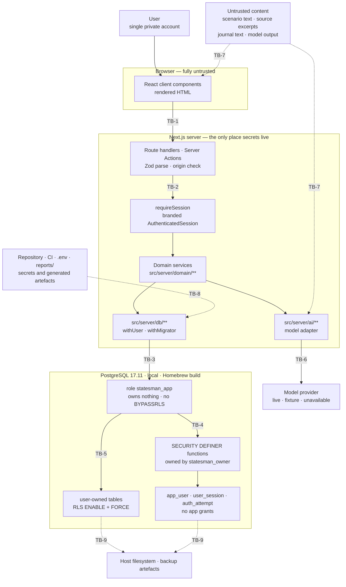
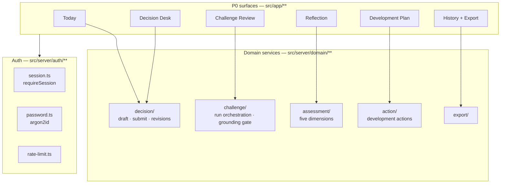
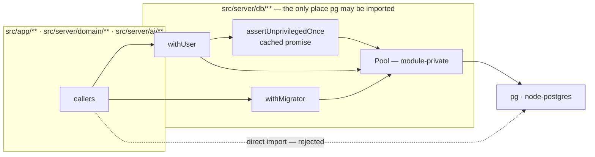
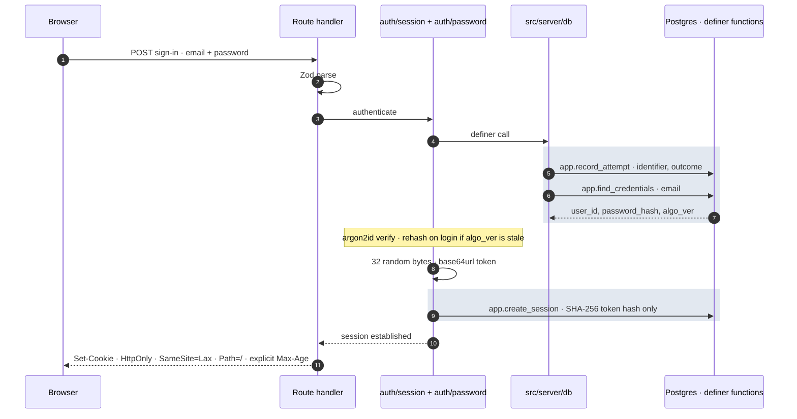
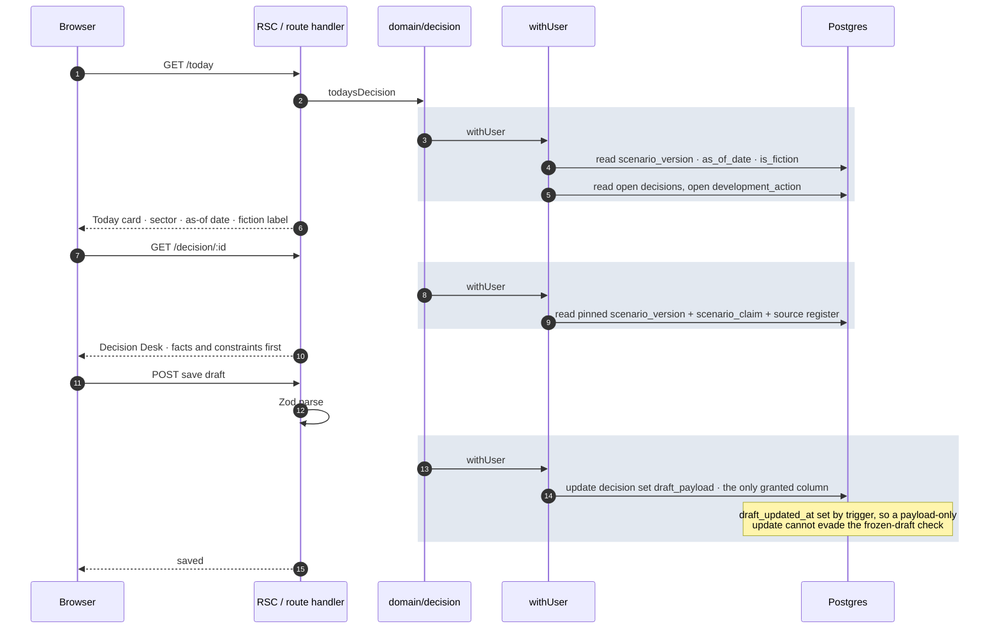
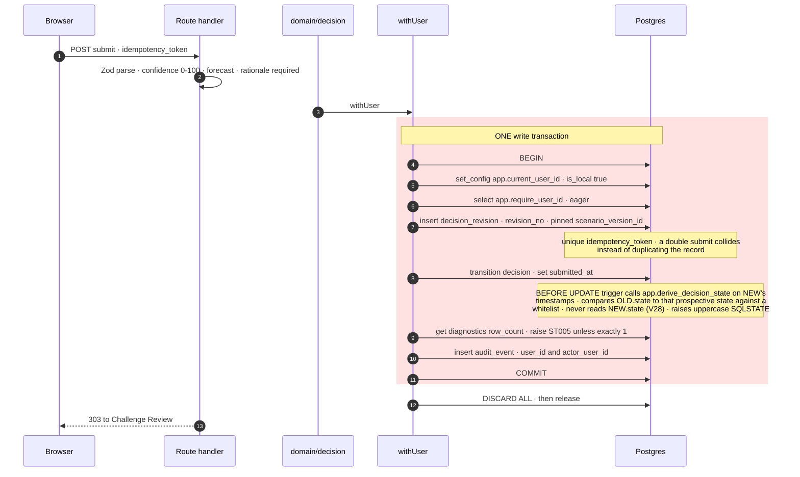
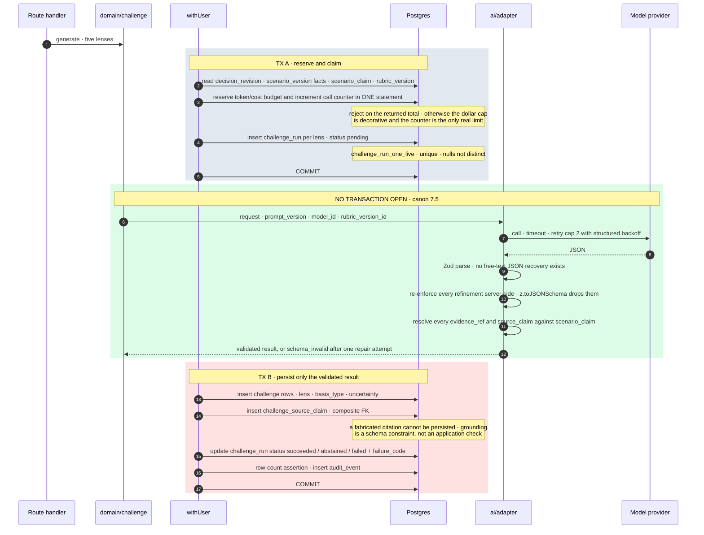
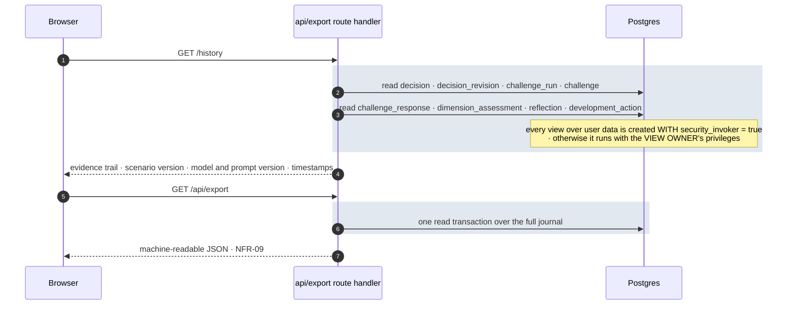
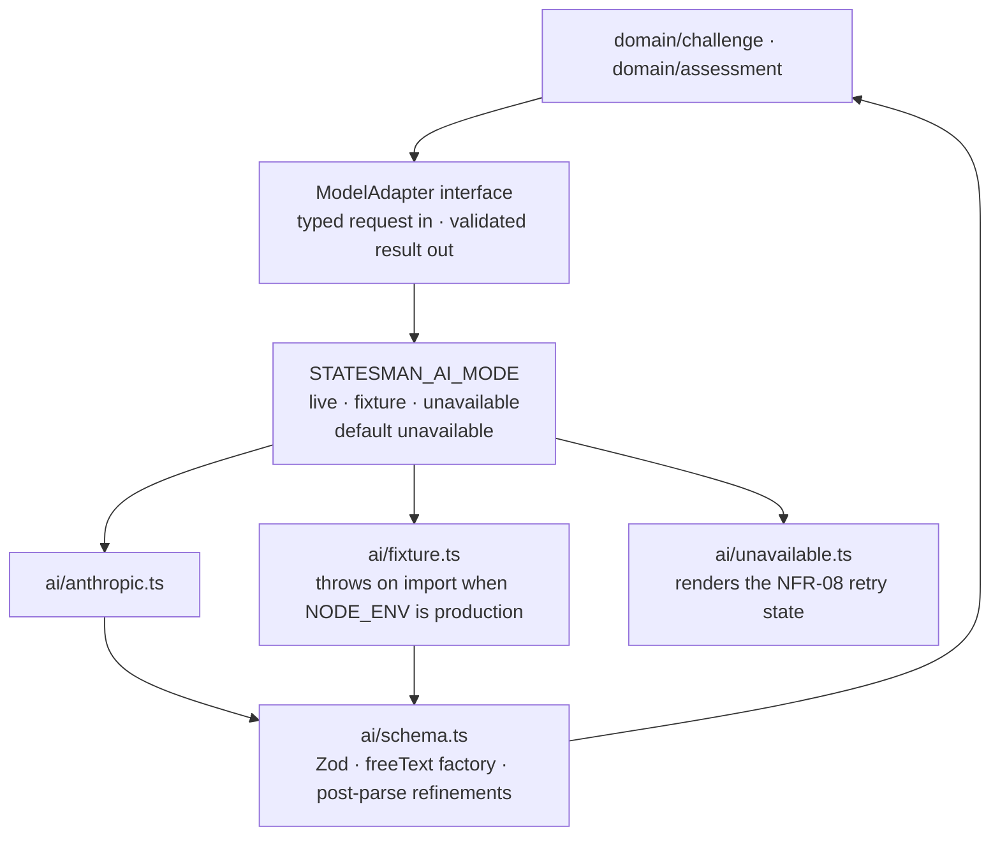

# STATESMAN OS — Architecture

**Document ID:** SOS-ARCH-001
**Date:** 2026-10-20
**Status:** Design intent. **No application code exists.** Nothing described here has been built, run or tested.
**Derives from:** `docs/superpowers/specs/2026-10-20-statesman-os-p0-mvp-design.md` (SOS-DESIGN-001, the canon), `docs/PRD.md` (SOS-PRD-001 v1.0), `docs/MASTER_PROMPT.md` §3.1

> The canon wins. Where this document disagrees with SOS-DESIGN-001, this document is the
> bug. Verified facts established by command against this machine on 2026-10-20 are cited
> as `(V1)`…`(V29)` and are not re-derived here.

---

## 0. Status

The repository contains documentation only. **No application code exists**: no
`package.json`, no `src/`, no `migrations/`, no test file and no CI pipeline. Every path,
module and command below is **planned**. This document makes no claim about which other
documents exist (canon §12: repository-state claims about sibling documents are owned by
nobody and must not be made).

| P0 component | FRs | Canon ref | Code |
|---|---|---|---|
| Decision Desk | FR-01, FR-02, FR-03 | §1.1 | none written |
| Decision Journal | FR-04, FR-05 | §1.1 | none written |
| Challenge Review | FR-07, FR-08, FR-09 | §1.1 | none written |
| Development Plan | FR-10, FR-11, FR-12 | §1.1 | none written |
| Private workspace | FR-14, FR-15, FR-16, FR-19 | §1.1 | none written |
| Supporting surfaces: Today, Reflection | — | §1.1 | none written — not standalone products |

Out of P0 scope per canon §1.2: FR-06, FR-13, FR-17, FR-18. Their requirement status is
carried by the register, not by this document.

The NFRs are design targets. **None is measured**, and PRD §11 is explicit that its
targets "are proposed design acceptance targets, not current measured performance". Where
this document carries an NFR:

| NFR | Architectural touchpoint here |
|---|---|
| NFR-01 Privacy and access control | TB-2, TB-3, TB-4, TB-5 (§5); `withUser` lifecycle (§4) |
| NFR-02 Security — encryption at rest | §8.3 — **no in-database mechanism**; stands as open release item O1, an undischarged obligation, and carries a `manual` verification leg (canon §12.3) |
| NFR-03 Auditability | `audit_event` with distinct `user_id` and `actor_user_id`; `on delete restrict` (§8.3) |
| NFR-04 Usability / responsive | not an architecture concern; the 320px overflow detector and its `/__a11y-canary` fault fixture live in canon §8.5 |
| NFR-05 Accessibility WCAG 2.2 AA | axe gate and focus-**difference** assertion, canon §8.5 |
| NFR-06 Reliability ≥99.5% monthly | no deployment exists to measure (§8.1); the deferral is ours, not the PRD's, so it is recorded in `docs/decisions.md` (canon §12.2) |
| NFR-07 Core screen load ≤3s | no environment to measure in; canon §12.2 requires either a throttled Playwright budget with its own positive control or a written deferral in `docs/decisions.md` — it may not sit silently |
| NFR-08 AI resilience | `unavailable` mode, draft preservation, retry state (§7.2) |
| NFR-09 Data portability | export route (§3.6) |
| NFR-10 Source integrity | `source`, `scenario_claim` as the grounding whitelist (canon §7.3), plus the `source.status` column and `scenario_version` archival flag required by canon §12.1 item 4 |

**Status is not restated here.** Requirement design status is owned by
`requirements.yaml` and rendered deterministically into
`docs/requirements-traceability.md`, which also carries the full FR/NFR matrix with
implementation paths and test identities (canon §12). Only that register states whether a
requirement is `PLANNED` or `DEFERRED`; a status written here could drift from it.
Run outcomes (`PASS`, `FAIL`, `NOT RUN`) are not representable in any committed document
(canon §8.6) — they belong to `reports/trace.json`, and no run has happened.

---

## 1. System context

**The trust-boundary namespace `TB-1`…`TB-9` is owned by `docs/threat-model.md`** (canon
§12). The identifiers below are adopted from it verbatim; the canon defines no competing
set, and a divergence here is a bug in this document. Every threat row, test-case id and
residual-risk row in the threat model is numbered against this scheme, so renumbering is
not an option. The actor catalogue `AC-01`…`AC-06` is likewise the threat model's.



| ID | Boundary | Canon ref |
|---|---|---|
| TB-1 | Public network ↔ Next.js server process | §6 |
| TB-2 | Request handler ↔ authenticated domain code — `requireSession()` | §6, §6.1 |
| TB-3 | Application process ↔ Postgres, as `statesman_app` — `withUser()` | §6.1 |
| TB-4 | `statesman_app` ↔ `statesman_owner` and the definer functions | §4.2, §4.6 |
| TB-5 | User ↔ user, inside a single table — in-database tenancy | §4.3, §4.5, §10 |
| TB-6 | Application ↔ model provider | §7.1, §7.2, §7.3 |
| TB-7 | Untrusted content ↔ an interpreting context — prompt assembly and HTML rendering | §7.4 |
| TB-8 | Repository/CI ↔ secrets and generated artefacts | §8.6, §8.7 |
| TB-9 | Host/OS ↔ data at rest | §9 O1 |

The model provider never touches the database, and the browser never touches either. No
secret — `DATABASE_URL`, `ANTHROPIC_API_KEY`, session token — crosses TB-1 outbound.
**TB-3 is load-bearing for TB-5**: RLS enforces whatever identity the connection asserts,
so an identity set wrongly at TB-3 is enforced faithfully and wrongly at TB-5.

---

## 2. Components

### 2.1 Surfaces onto modules

Only `src/server/db/**` is fixed by the canon (§6.1). **File and test layout is owned by
`docs/implementation-plan.md`** (canon §12), which is ordered by migration dependency; the
paths below are illustrative and must be reconciled to it, never the reverse. A path named
here that no task creates is a defect in this document.



| Surface | PRD screen | Proposed path | Primary service |
|---|---|---|---|
| Today | §5.1 A | `src/app/today` | `domain/decision` |
| Decision Desk | §5.2 B | `src/app/decision/:id` | `domain/decision` |
| Challenge Review | §5.3 C | `src/app/decision/:id/challenge` | `domain/challenge` |
| Reflection | §5.4 D | `src/app/decision/:id/reflect` | `domain/assessment` |
| Development Plan | §5.4 D | `src/app/plan` | `domain/action` |
| History + Export | §5.5 E | `src/app/history`, `src/app/api/export` | `domain/export` |
| a11y canary | canon §8.5 | `src/app/__a11y-canary` | none — mounted only under `E2E_FAULTS=1` |

### 2.2 The server-only boundary and `pg` containment

`pg` is importable **only** from `src/server/db/**`. `withUser` and `withMigrator` are
the only exported data entry points; the `Pool` is module-private.



```ts
// src/server/db/index.ts — the ONLY exported data entry points
export async function withUser<T>(fn: (db: UserScopedClient) => Promise<T>): Promise<T>
export async function withMigrator<T>(userId: string, fn: (db: Client) => Promise<T>): Promise<T>
```

`withUser` takes **no session parameter** (canon §6.1). An identity arriving as an
argument type-checks perfectly when handed a victim's id, and RLS then faithfully
enforces the attacker's chosen identity. Removing the parameter removes the channel.

`AuthenticatedSession` and `UserScopedClient` are branded with a `unique symbol`
producible only inside `requireSession` / `withUser`. A brand is erasable with one
assertion, so `as AuthenticatedSession` and `as UserScopedClient` are additionally banned
by an AST check.

| Enforcement | Mechanism | Why the cheaper option is insufficient | Status |
|---|---|---|---|
| `pg` import containment | AST script over the TypeScript API, seeing static `import`, `require` and dynamic `import()` | `no-restricted-imports` matches the specifier string, not the resolved path; a grep for `new Pool(` is evaded by an alias (canon §6.1) | PLANNED |
| Brand non-forgery | AST ban on the two `as` casts | TypeScript cannot prevent an assertion | PLANNED |
| Role identity | `assertUnprivilegedOnce()` at runtime | `pg_hba.conf` is `trust`, so a typo'd role connects successfully with no password error (V1) | PLANNED |
| Posture | `verify_security_posture()`, 10 rules, end of every migration run in every environment, and integration test #1 | A test-setup-only check does not run in the environment that matters (canon §4.8) | PLANNED |

---

## 3. Runtime flow — the P0 journey

Split into six diagrams. Transaction boundaries are the shaded blocks; every one of them
is a `withUser` lifecycle (§4 below) unless labelled otherwise.

### 3.1 Sign-in — the pre-identity path

No user context exists yet, so this path cannot pass RLS. It crosses TB-4 instead — the
definer-function boundary.



Password hashing is argon2id via `@node-rs/argon2`, and **its parameters are recorded in
ADR-0002** — the authentication decision, not ADR-0005, which is the privilege decision.
The pinned starting values are `memoryCost = 19456` KiB, `timeCost = 2`,
`parallelism = 1`, a 16-byte salt and a 32-byte output: the RFC 9106 / OWASP low-memory
baseline. They are a **decision, not a measurement** — the option names and defaults must
be read back from the installed `@node-rs/argon2` release before use (open item O4), and a
unit test must assert the hashing call uses exactly these values, so later drift fails
the build. `algo_ver` is what makes rehash-on-login possible.

The token itself is never stored (canon §6). `Secure` and the `__Host-` prefix are
production-only, because `__Host-` requires `Secure` and local http cannot satisfy it.
Rate limiting is per-identifier progressive delay with the DB client **released before
sleeping**; there is no lockout and no instance-wide circuit breaker — on a single-user
app that is account lockout with a one-line attacker trigger (canon §6).

`resolve_session` is a **pure read**. Idle expiry is slid conditionally
(`last_seen_at < now() - interval '15 minutes'`) and fire-and-forget, otherwise Next.js
prefetches renew the window with no user activity and the idle control is hollow while
its test still passes.

### 3.2 Today → open scenario → save draft



A partial unique index enforces one open draft per user per scenario version.

### 3.3 Submit — the locking transaction

One transaction. One new append-only revision. No overwrite, ever.



`state` is never written directly. **One `IMMUTABLE` function,
`app.derive_decision_state(submitted_at, challenged_at, reflected_at,
action_recorded_at, closed_at)`, is the sole definition of what the state is, and it is
used twice** (canon §4.4):

1. `decision.state` is `GENERATED ALWAYS AS (app.derive_decision_state(…)) STORED`. An
   `IMMUTABLE` user-defined SQL function **is** accepted in a generated expression (V29).
   Inside it, each branch casts its own enum literal, because
   `CASE … END::app.decision_state` is rejected as not immutable — `enum_in` is `STABLE`,
   while per-branch literals constant-fold (V12).
2. The `BEFORE UPDATE` transition trigger calls the **same** function on `NEW`'s
   timestamps to obtain the **prospective** state, and compares `OLD.state →
   prospective` against a whitelist, raising uppercase custom SQLSTATEs.

**The trigger must never read `NEW.state`.** `NEW.<col>` is NULL in a `BEFORE UPDATE`
trigger when that column is `GENERATED` — reproduced: `OLD.state=[draft]`,
`NEW.state=[<NULL>]`, while `AFTER` correctly reports `[submitted]` (V28). A trigger
written the obvious way therefore compares every transition against NULL and so permits
everything or rejects everything; it is inert, not strict. Using one derivation function
for both the column and the guard is also what stops the two drifting apart, and the
control for that is a meta-test over **all 32 combinations** of the five milestone
timestamps asserting that the function's result and the stored column agree.

The row-count assertion exists because a failing RLS `USING` clause affects zero rows and
raises nothing (V7) — silence is not success.

Custom SQLSTATEs are uppercase, and a round-trip test is required: a lowercase code such as `'st010'`
silently resolves to `42704` (V13). The API maps each code to a distinct HTTP status, so
404 and 409 stay distinguishable — which is exactly why RLS does not encode transitions
(canon §4.4).

### 3.4 Five-lens challenge generation — the model call is outside the write transaction



The model call sits between two transactions and holds none, because a failing AI call
must not delete a draft, mutate a locked revision, or mark review complete (canon §7.5).
A challenge whose citations do not all resolve is dropped individually and the drop is
recorded with a `failure_code`. The idempotency key is partial over the live-status set,
so a **failed** run can be retried rather than permanently returning its failure.

Per-minute and per-decision allowances are separate, so a legitimate five-lens run plus
repairs is not rejected.

### 3.5 Respond / dispute → reflect → create action

```mermaid
sequenceDiagram
  autonumber
  participant B as Browser
  participant S as Route handler
  participant P as Postgres

  B->>S: respond to challenge · accepted / disputed / flagged_incorrect
  rect rgb(254, 226, 226)
    S->>P: insert challenge_response · body preserved verbatim
    Note over P: FR-09 · flagged_incorrect is its own state and is<br/>excluded from "addressed"
  end

  B->>S: open Reflection
  rect rgb(220, 252, 231)
    Note over S,P: assessment generation · model call outside any write transaction
  end
  rect rgb(254, 226, 226)
    S->>P: insert dimension_assessment · assessor_kind ai · observed_level <= 2
    Note over P: CHECK ai_never_awards_practice_levels · the full 0-4 domain<br/>stays in the DB; the AI is constrained, not the product
    S->>P: insert assessment_observation + assessment_observation_source_claim
    S->>P: insert reflection
  end

  B->>S: create development action
  rect rgb(254, 226, 226)
    S->>P: insert development_action · origin_challenge_id and/or<br/>origin_dimension_assessment_id
    Note over P: FR-11 requires the link to originating feedback;<br/>FR-12 requires both attempts to remain visible
  end
```

A trigger additionally forbids any AI-path update of a `human_reviewer` row.

### 3.6 History and export



**Open item O2 lands here.** React `cache()` outside a render context is used for session
resolution in Route Handlers — including this export route, which dumps a full journal.
The canon requires this be settled empirically before it is relied on: put a
`randomUUID()` in the uncached implementation, fire two concurrent requests, and assert
the ids differ. If they do not, resolve per handler explicitly. The probe is PLANNED; no
execution has happened, so nothing is known about the outcome.

### 3.7 Transaction boundaries, collected

| Step | Transactions | Model call inside? | Notes |
|---|---|---|---|
| Sign-in | definer function calls | no | pre-identity, TB-4, no RLS context |
| Today, Desk read | 1 read | no | |
| Save draft | 1 write | no | `draft_payload` is the only granted column |
| **Submit** | **1 write** | **no** | revision insert + transition + audit, all or nothing |
| Challenge generation | **2** — reserve, then persist | **no — between them** | canon §7.5 |
| Respond / dispute | 1 write | no | |
| Reflection | 2 — reserve, then persist | no — between them | same shape as challenge |
| Create action | 1 write | no | |
| History, export | 1 read | no | O2 unsettled |

---

## 4. The `withUser` transaction lifecycle

Exactly as canon §6.1, in order.

1. **`await assertUnprivilegedOnce()`** — a cached promise, so **every** path validates the
   connection's role once per process, independent of framework lifecycle hooks.
   *Why:* `pg_hba.conf` is `trust` for local, `127.0.0.1` and `::1` and the login role is
   `rolsuper=t, rolbypassrls=t`, so a typo'd username in `DATABASE_URL` connects
   *successfully* as whatever role it names with no password error (V1) — and an attribute
   check alone is not enough, because a role with `rolbypassrls=false` that is a **member**
   of a BYPASSRLS role passes the attribute check yet `SET ROLE` to it succeeds (V3), so
   reachability is tested with `pg_has_role(…, 'MEMBER')`.
2. **`BEGIN`**
3. **`select set_config('app.current_user_id', $1, true)`** — transaction-local.
4. **`select app.require_user_id()`** — eager validation, one extra round trip.
   *Why:* with no context set, `select … where id='<nonexistent uuid>'` returns rc=0, zero
   rows and **no error**, because the policy raises only when a candidate row actually
   reaches the qual (V6) — so without an eager call, missing context is byte-identical to
   an empty result and the failure mode depends on query shape.
5. **The caller's work.**
6. **`COMMIT` / `ROLLBACK`.**
7. **`finally`: `DISCARD ALL`, then release.**
   *Why:* a transaction-local GUC reverts to the **empty string**, not NULL, at COMMIT
   (V5), so a connection returning to the pool carries residue rather than a clean absence;
   `DISCARD ALL` makes a mistaken `is_local=false` **inert rather than merely tested-for**,
   which is the structural answer to the pooled-identity-leak case in canon §7.6.

`set local statement_timeout` is applied through `set_config($1, $2, true)` with a
Zod-validated number — **zero interpolated values** in transaction setup.

`withUser` contains **no** rollback branch and no `process.env` reference. Per-test
transaction isolation is injected by test-only code through an optional provider, and a
unit test asserts production code has no env-gated rollback path (canon §8.3).

---

## 5. Trust boundaries

Identifiers are `docs/threat-model.md`'s (canon §12), adopted verbatim — see §1. Section
references in the table are the canon's.

| ID | Boundary | What crosses | What validates it | What is assumed |
|---|---|---|---|---|
| **TB-1** | Public network ↔ Next.js server process (§6) | HTTPS request; session cookie; form payloads; journal text; rendered RSC/HTML out | Zod parse at the handler; cookie attributes `HttpOnly`, `SameSite=Lax`, `Path=/`, explicit `Max-Age`, plus `Secure` and the `__Host-` prefix in production; **origin verification on every state-changing Server Action and Route Handler** (canon §12.1 item 1 — `SameSite=Lax` alone is not the control); one escaping render component plus a CSP for all journal text and model output (canon §12.1 item 3) | TLS in production. The browser is fully untrusted and holds no secret. `Secure` and `__Host-` are production-only because local http cannot satisfy them. |
| **TB-2** | Request handler ↔ authenticated domain code (§6, §6.1) | A presented session token | `requireSession()` resolving the token to a live, unexpired, unrevoked row whose `privilege_epoch_at_issue` still matches, returning a branded `AuthenticatedSession`; `resolve_session` is a **pure read** and idle sliding is conditional and fire-and-forget | Nothing about the caller. The brand is producible only inside `requireSession`, and because one `as` assertion erases a brand, both casts are banned by an AST check. |
| **TB-3** | Application process ↔ Postgres, as `statesman_app` (§6.1) | Every user read and write, carrying only `app.current_user_id` as a transaction-local GUC | `withUser()` as the only exported data entry point with the `Pool` module-private; `assertUnprivilegedOnce()` testing role identity and BYPASSRLS **reachability by membership** with `pg_has_role(…, 'MEMBER')` (V1, V3); eager `app.require_user_id()` (V6); `DISCARD ALL` before release (V5); AST containment of `pg` to `src/server/db/**` | **Nothing is assumed about the connection's role.** It is asserted at runtime, because `pg_hba.conf` is `trust` and a typo'd role name in `DATABASE_URL` connects successfully with no password error (V1). This boundary is load-bearing for TB-5. |
| **TB-4** | `statesman_app` ↔ `statesman_owner` and the definer functions (§4.2, §4.6) | Email; password; SHA-256 token hash — **never the token**; the erasure call | **Grant-absence** on `app_user`, `user_session` and `auth_attempt`, which is strictly stronger than RLS; `SECURITY DEFINER` functions owned by `statesman_owner`, each with `set search_path = pg_catalog, public`, each granted to `statesman_app` only, one explicit line each; `app.erase_self()` derives identity internally and **never takes a uuid** (V2) | That `EXECUTE` is never re-granted to `PUBLIC` — asserted by posture rule 4, not assumed, because a `SECURITY DEFINER` function is created with `EXECUTE` granted to `PUBLIC` by default and this reproduced cross-user deletion as the unprivileged app role (V2). |
| **TB-5** | User ↔ user, inside a single table (§4.3, §4.5, §10) | Every row a query touches, matched against the GUC identity | RLS `ENABLE` **and** `FORCE` on every user-owned table; policies carrying tenancy only and **omitting `TO`** (V9); composite FKs making ownership a schema constraint (§4.5); row-count assertions, because a failing `USING` clause affects zero rows and raises nothing (V7); `verify_security_posture()`'s 10 rules | **Nothing about the application layer.** Tenancy is enforced below it: `statesman_app` owns nothing (V4), has no BYPASSRLS directly or by membership (V1, V3), and `app.require_user_id()` stays `STABLE` — an `IMMUTABLE` variant was proven to let a prepared statement leak one user's rows to another from the second execution onward, so `provolatile = 's'` is a catalog assertion because it cannot be scheduled away. |
| **TB-6** | Application ↔ model provider (§7.1, §7.2, §7.3) | **Out:** approved `scenario_version` facts, the `scenario_claim` registry, the user's `decision_revision`, the `rubric_version`, one lens, `prompt_version`, `model_id`. **In:** one JSON object per PRD §9.2. | `STATESMAN_AI_MODE` explicit, never inferred; schema-constrained output; Zod parse; server-side re-enforcement of every refinement because `z.toJSONSchema()` drops them (V25); one `freeText(min,max)` factory with a meta-test failing any `ZodString` leaf it did not produce; the `scenario_claim` citation whitelist; composite-FK grounding; per-challenge drop with `failure_code` | **Nothing about model compliance.** There is no reliance on instructing the model to ignore instructions. Assumed only that the provider endpoint is reachable and that the API key never reaches the client. |
| **TB-7** | Untrusted content ↔ an interpreting context (§7.4) | Scenario text, source excerpts, journal text **and model output**, entering prompt assembly (TB-6) or HTML rendering (TB-1) | Role separation; explicit delimiting with generated boundary tokens; schema constraint and post-parse validation; citation whitelist; escaping at render through a single component plus a CSP | **Nothing.** Note the residual the canon names: the `freeText` factory rejects URIs and control characters but **not** HTML metacharacters, so escaping at render is load-bearing rather than defence in depth (canon §12.1 item 3). |
| **TB-8** | Repository/CI ↔ secrets and generated artefacts (§8.6, §8.7) | `.env` values; worker connection bases; `reports/` output; logs and telemetry | No credentials in a handoff file — workers read connection bases from their own environment; `reports/` gitignored; secret scan **before and after** the test gates so generated artefacts are covered; field classification plus redaction of journal values, tokens and connection strings from every log and telemetry payload, with a deliberately-logging fixture as the positive control (canon §12.1 item 2) | That the dependency-audit and secret-scan thresholds are written down rather than applied at discretion — canon §12.2 requires the dependency-audit threshold to be stated in `CLAUDE.md`. |
| **TB-9** | Host/OS ↔ data at rest (§9 O1) | Database files; `pg_dump` artefacts | **Nothing is asserted.** Postgres has no TDE; FileVault locally, an encrypted volume on any deploy | Nothing. This is O1, an undischarged NFR-02 obligation with a `manual` verification leg (canon §12.3), not a met control. |

The worked prompt-injection example, the stopping layer, the threat register and the
residual-risk register belong to `docs/threat-model.md` (canon §7.4, §12).

### 5.1 Four controls the threat model found undesigned

The threat model marked four controls `UNDESIGNED`. Canon §12.1 puts all four **in P0
scope, in Slice 6**, so they are boundary obligations here rather than open questions:

| Control | Boundary | What it requires |
|---|---|---|
| CSRF origin verification | TB-1 | Origin checked on **every** state-changing Server Action and Route Handler. `SameSite=Lax` alone is not the control. Needs a RED cross-origin E2E case with a same-origin positive control, and an ADR recording the mechanism. |
| Log and telemetry redaction | TB-8 | A field classification, plus a RED test that runs a full loop and asserts no journal field value, token or connection string appears in any captured log or telemetry payload — with a deliberately-logging fixture as the positive control. |
| Stored-XSS rendering | TB-7, TB-1 | All journal text and model output rendered through one escaping component, plus a CSP. The `freeText` factory rejects URIs and control characters but **not** HTML metacharacters, so render-time escaping is load-bearing, not defence in depth. |
| NFR-10 source integrity | TB-6 data inputs | `source` gains a `status` column (`active \| withdrawn \| unreachable`) and `scenario_version` an archival flag, with a CI assertion that a seeded withdrawn source is reported. The PRD requires flagging and archival, not only stored dates. |

---

## 6. Role and privilege model

### 6.1 Three roles

| Role | Login | Owns | Granted | Not granted |
|---|---|---|---|---|
| `statesman_owner` | `nologin` | the schema and the `SECURITY DEFINER` functions | — | — |
| `statesman_app` | `login`, `noinherit`, `nobypassrls`, `nosuperuser`, `nocreatedb`, `nocreaterole` | **nothing** (V4) | per-table grants written one migration at a time; `EXECUTE` on each definer function, one explicit line each | `TEMPORARY` (revoked — V22); `TRUNCATE` on immutable tables; any grant on `app_user`, `user_session`, `auth_attempt`; `CREATE` on schema `public` |
| `statesman_migrator` | `login`, `noinherit` | — (is a member of `statesman_owner`) | `statesman_owner` | BYPASSRLS, superuser |

The application connects **only** as `statesman_app`. `search_path` is pinned
(`alter role statesman_app set search_path = 'public'`) and everything is
schema-qualified, because the app role otherwise retains PUBLIC's `TEMPORARY` privilege
and a temp table **shadows** an unqualified reference to a real table (V22).

### 6.2 The fail-closed asymmetry

Tables and functions get **opposite** treatment, because their Postgres defaults point in
opposite directions.

```sql
-- FUNCTIONS: the default is ALLOW, so the default must be revoked.
revoke all on all functions in schema public, app from public;
alter default privileges in schema public, app revoke execute on functions from public;
-- then GRANT EXECUTE per function, explicitly, one line each.

-- TABLES: the default is DENY, so there is deliberately NO
-- `alter default privileges ... grant`. Each migration grants per table.
```

| | Postgres default | Canon's move | A forgotten line yields | Direction |
|---|---|---|---|---|
| **Functions** | `EXECUTE` to `PUBLIC` (`pg_proc.proacl IS NULL`) — V2 | **REVOKE** the default, then grant explicitly | an **executable-by-anyone** definer function | would fail **open** — so the default is removed |
| **Tables** | no privilege to anyone | **omit** `ALTER DEFAULT PRIVILEGES … GRANT`; grant per table per migration | an **invisible** table | fails **closed** |

That asymmetry is the whole point. A forgotten table grant produces a broken feature,
which is loud and cheap. A forgotten function revoke produces a silent cross-user
capability — V2 reproduced exactly that: cross-user deletion as the unprivileged app
role. `REVOKE … ON ALL TABLES` does not touch `EXECUTE`, so the two statements are not
interchangeable and the pair in canon §4.2 is not redundant.

Posture rules 1 and 2 are deliberately **column-name independent**: an
`attname='user_id'` selector was proven to exclude `app_user`, whose column is `id`, and
every indirectly scoped table. Rule 2 makes a newly added public table fail by default
unless it is in a version-controlled allowlist of global reference tables.

---

## 7. Model-provider abstraction

### 7.1 The adapter boundary



Everything above the interface is provider-ignorant. A provider swap touches
`ai/anthropic.ts` plus one row in the provider→provenance mapping, and nothing else: the
schema, the grounding gate, the budget reservation and the persistence path do not name a
provider. That containment is what PRD §13 "Overdependence on a single AI vendor" asks
for.

### 7.2 Mode is explicit, never inferred

```ts
STATESMAN_AI_MODE: 'live' | 'fixture' | 'unavailable'   // default 'unavailable'
```

Mode is **never** keyed on the absence of `ANTHROPIC_API_KEY`. An implicit trigger would
ship canned feedback as the production default. The fixture adapter module **throws on
import** when `NODE_ENV === 'production'`. A missing key in `live` mode renders the
NFR-08 unavailable/retry state — it does not silently fall back.

| Mode | Use | Provenance | `provider` | UI |
|---|---|---|---|---|
| `live` | real provider call | `live` | provider id | normal |
| `fixture` | deterministic test and demo only | `fixture` | `fixture` | **every response labelled fixture-backed** |
| `unavailable` | default; no provider configured | n/a — no run persisted as succeeded | n/a | honest retry state, draft preserved |

Provenance is derived from the provider by **one** mapping function and tied by a database
`CHECK`, so the label cannot drift from the fact:

```sql
check ((provider = 'fixture') = (provenance = 'fixture'))
```

### 7.3 Versioning

Every `challenge_run` row records `prompt_version`, `rubric_version_id`, `model_id`,
`provider`, `provenance` and `generated_at`. `rubric_version` is a reference table written
only by migration/seed. A prompt or rubric change is therefore a new version row, not an
edit, and history reconstructs which prompt and rubric produced which challenge —
PRD §5.5 and FR-15.

`extractJson` free-text JSON recovery is **deleted**. On a parse failure: one repair
attempt through the operator channel, then `{code:'schema_invalid'}`. A unit test asserts
no substring or regex JSON recovery exists in the adapter.

### 7.4 Adversarial evaluation

The suite covers prompt injection, missing citations, invented legal authority,
unapproved source id, contradictory case facts, sycophantic praise, stereotyping,
unjustified certainty, **IDOR against another user's `decision_revision` and
`challenge_run` including through every view**, and **pooled-identity leak across two
sequential requests on one warmed client**.

Structural cases — schema violation, unapproved source, zero-citation gap, IDOR, identity
leak — are **release blockers**, scored automatically. Judgemental cases — sycophancy,
stereotyping — go to the PRD §12.3 reviewer-sample protocol, because a fixture suite
scored against responses we wrote ourselves verifies our validators, not the model.
Status: PLANNED — the suite is not written, so no case has been exercised.

---

## 8. Deployment and backup model

### 8.1 Deployment: none

**Local development only.** No deployment is authorized (MASTER_PROMPT §12.9: no
deployment to production or expenditure without explicit user authorization). There is no
hosting provider, no CI/CD target, no domain and no production environment. The
`Secure`/`__Host-` cookie attributes and the `NODE_ENV === 'production'` fixture guard are
written for a production that does not exist yet.

| Environment | State | Postgres | AI mode |
|---|---|---|---|
| Local development | planned; nothing provisioned | PostgreSQL 17.11, local Homebrew build | `fixture` or `unavailable` |
| Test | planned; nothing provisioned | per-worker `CREATE DATABASE … TEMPLATE statesman_test_template` | `fixture` |
| Production | **none — not authorized** | — | — |

### 8.2 Two machine facts the runbook must carry

| Fact | Consequence for the runbook |
|---|---|
| `brew services list` reports `postgresql@17` as `none` — the running server is **not brew-managed** and will not survive a reboot (V26) | The runbook says `brew services start postgresql@17`. "It was running yesterday" is not a start condition. |
| Postgres requires `LC_ALL` set on this macOS build or the postmaster aborts with *postmaster became multithreaded during startup* (V27) | The runbook **and every script** export `LC_ALL=en_US.UTF-8`. A script that omits it fails at startup, not at query time. |

### 8.3 Backup

Dump **as the bootstrap superuser**, not as the owner role.

```sh
export LC_ALL=en_US.UTF-8                       # V27
pg_dump --format=custom --no-owner --no-privileges \
  --dbname="postgresql://stefangravesande@127.0.0.1/statesman" \
  --file="statesman-$(date -u +%Y%m%dT%H%M%SZ).dump"
```

`pg_dump` as the **non-superuser owner** under `FORCE ROW LEVEL SECURITY` fails with
**rc=1** (V10). This is the good outcome: the "silently empty backup" hazard that would
normally justify a round-trip row-count verification **does not exist here**, because the
failure is loud. That verification step is accordingly listed in canon §11 as cut — the
dump either succeeds or exits non-zero, and a non-zero exit is the alarm.

Restore is a `pg_restore` into a fresh database as the bootstrap superuser, followed by
`verify_security_posture()`, which is the meaningful post-restore assertion: it proves RLS,
forcing, policy shape, ownership, function privileges, view invoker-rights, volatility,
truncate-absence, sentinels and NOT NULL all survived the round trip. Status: PLANNED —
no database exists to dump, so the drill has never been attempted.

| Concern | Position | Status |
|---|---|---|
| Backup command | `pg_dump` as bootstrap superuser, custom format | PLANNED |
| Backup schedule | none defined; this is a local single-user MVP | DEFERRED |
| Restore drill | `pg_restore` + `verify_security_posture()` | PLANNED |
| **NFR-02 encryption at rest** | Postgres has no TDE. FileVault locally; a managed or encrypted volume on any deploy. **Declared an open release item (O1), not silently met** — an undischarged obligation, not a deferral out of P0. Status is the register's; see §0. | — |
| Deletion vs backups | the privacy notice states the real retention behaviour **including backups**. **No immediate-erasure promise.** | PLANNED |

Deletion itself runs through `app.erase_self()`, which enumerates owner columns from a
single shared classification, writes the `account_deleted` audit row with
`actor_user_id IS NULL`, resets its erasure flag explicitly — because `set_config(…, true)`
inside a function carrying a `SET` clause **persists** after the function returns (V17) —
and guards on `pg_trigger_depth() > 1` **and** `current_setting('app.erasure', true) = 'on'`
together, because depth alone is 2 both inside a cascaded delete and when the owner types
a plain parent `DELETE` (V16). Foreign keys from `app_user` are `on delete restrict`, not
cascade: a cascade silently destroys the audit history that NFR-03 and FR-16 require.

---

## 9. Supabase portability

The canon chose local PostgreSQL with hand-written migrations and its own session-cookie
auth; **no Docker, no Supabase** (canon §2, recorded as ADR-0001). MASTER_PROMPT §4
proposed Supabase Auth and RLS as a default "if no existing
architecture constrains you", so this is a deliberate, recorded deviation rather than an
oversight.

One seam exists for a later port: `app.current_user_id()`, a thin **non-raising** alias
that maps to `auth.uid()`. It is **not used in policies** (canon §4.3). That is the whole
seam. Three things change, and none of them is a configuration flip.

**1. The auth shim.** Supabase Auth replaces `app_user`, `user_session`, `auth_attempt`
and the **nine** definer functions of canon §4.6 — `app.create_user`, `app.find_credentials`,
`app.create_session`, `app.resolve_session`, `app.revoke_session`, `app.touch_session`,
`app.record_attempt`, `app.erase_self`, `app.get_profile` — the entire TB-4 surface. But
`auth.uid()` returns NULL rather than raising, and a transaction-local GUC reverts to the
empty string rather than NULL (V5), so the **raising** accessor `app.require_user_id()` must be kept on
top of it and every policy must continue to call the raising one. Dropping to `auth.uid()`
in policies reintroduces V6 and V7 wholesale: no context becomes zero rows and no error.
`app.require_user_id()` must also stay `STABLE`, for the prepared-statement leak reason in
canon §4.3, regardless of what sits underneath.

**2. The grant model.** This is the deep incompatibility. The canon's fail-closed table
property comes from **deliberately omitting** `ALTER DEFAULT PRIVILEGES … GRANT` on tables
(canon §4.2), so a forgotten grant yields an invisible table. Supabase ships default grants to
its `anon` and `authenticated` roles, which is the opposite default; a new table there is
reachable unless something stops it. Re-establishing fail-closed means overriding the
platform's own bootstrap, and `verify_security_posture()` rules 1, 2 and 4 would have to be
rewritten against Supabase's role graph rather than retired. Further:
`assertUnprivilegedOnce()` tests V1/V3/V4 — role identity, BYPASSRLS reachability by
membership, and non-ownership — against a role graph that includes a `service_role` with
BYPASSRLS; the reachability test must be re-derived, not reused. And Supabase's generated
policies conventionally carry `TO authenticated`, which is **precisely** the construct V9
proved makes `FORCE`d tables unreadable by their owner and definer functions. The canon's
"policies omit the `TO` clause" rule is not a stylistic preference there; it is load-bearing.

**3. The fail-loud property.** V10 — `pg_dump` as non-superuser owner under `FORCE` fails
with rc=1 — is a property of having a **bootstrap superuser** on the machine. On managed
Supabase there is no such role available to the operator, so the backup path becomes the
platform's, and the loud-failure guarantee that justified cutting round-trip verification
(canon §11) must be re-established against that tooling before the verification step can
stay cut.

**Assessment: not a drop-in swap.** The seam makes the *identity source* portable. It does
not make the privilege model, the posture check, the backup guarantee or the pre-identity
path portable. A port is a project with its own ADR, its own posture-check rewrite and its
own adversarial pass — not a connection-string change.

---

## 10. What this document does not decide

Each row names the **owner** of a concern this document deliberately does not settle.
Ownership, not existence: per canon §12 no document asserts which other documents exist.

| Concern | Owner |
|---|---|
| Threats, mitigations, residual risk, the worked prompt-injection example and the stopping layer; the `TB-n`, `T-nn` and `TC-SEC-nnn` namespaces | `docs/threat-model.md` |
| FR-01…FR-19, NFR-01…NFR-10 mapped to paths and test identities, and every requirement's design status | `requirements.yaml`, rendered into `docs/requirements-traceability.md` |
| ADR numbers and the reserved-number list | `docs/adr/README.md` |
| ADR-0001 local Postgres over Supabase; ADR-0002 own session-cookie authentication, **including the argon2id parameters**; ADR-0003 keep `FORCE` and omit `TO`; ADR-0005 privileges fail closed | `docs/adr/` |
| Migration filenames, source and test file layout, ordered vertical slices with RED/GREEN tests and verification commands | `docs/implementation-plan.md` |
| Project instructions, commands, conventions, definition of done, the dependency-audit threshold (canon §12.2) | `CLAUDE.md` |
| Conflicts with PRD intent that are resolved rather than met — the NFR-06 deferral, the NFR-07 disposition, the coverage threshold (canon §12.2) | `docs/decisions.md` |

Open items from canon §9 that bear on architecture: **O1** NFR-02 has no mechanism;
**O2** React `cache()` for session resolution in Route Handlers must be settled empirically
(§3.6 above); **O3** Node v25.5.0 is an odd-numbered line, so async `cookies()` and
`instrumentation.ts` semantics are verified against the installed release, not from memory;
**O4** every framework and library assertion is settled by command before use and recorded
in the ADR that cites it; **O5** V26 and V27 go in the runbook; **O6** FR-13 reviewer
sharing is deferred and the MVP ships **no** global `role` column — a global role cannot
express per-item scoped revocable sharing.

Three structural questions this document could not answer from the canon and that the
implementation plan must close are listed in the handover note accompanying it: the
privileged write path that sets `decision.submitted_at` given that `statesman_app` holds
`grant update (draft_payload)` **only**; whether `withMigrator` is reachable from the
application runtime at all, given that canon §4.1 states the application connects only as
`statesman_app`; and whether `statesman_migrator` issues an explicit `SET ROLE
statesman_owner`, since it is created `noinherit`.
